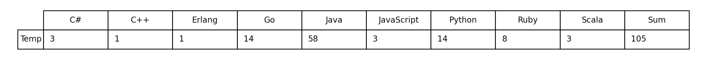
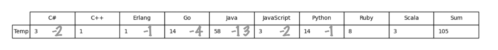
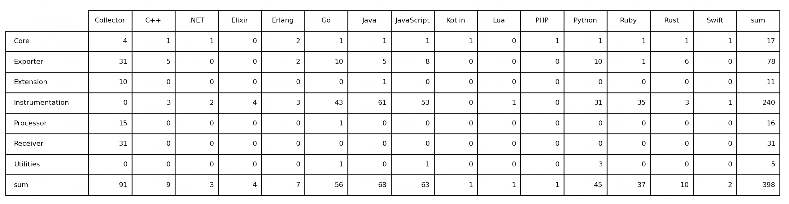

# opentelemetry_empirical
This repository maintains all the experiments and results in the paper xx.

The [README](https://github.com/xpxxx/opentelemetry_empirical/blob/main/README.md) introduces the configuration environment and input/output of each experiment.

##  RQ1

This section include following document:

[**count_registry_ot.py**](https://github.com/xpxxx/opentelemetry_empirical/blob/main/RQ1/count_registry_ot.py) This script counts the repositories maintained by OpenTracing based on languages. You can run this script with the following command. The result will be similar to [Table_1_temp](https://github.com/xpxxx/opentelemetry_empirical/blob/main/RQ1/Table_1_temp.png) and updated as the [information](https://github.com/orgs/opentracing-contrib/repositories) in OpenTelemetry is updated

`python count_registry_ot.py`

**BUT** repositories maintained by OpenTracing are not sorted by their  properties and we concentrated on those repositories instrumented. So we have double checked manually to delete some repositories not related to instrumentation as shown as [Table_1](https://github.com/xpxxx/opentelemetry_empirical/blob/main/RQ1/Table_1_manually.jpg).

[**count_registry_otel.py**](https://github.com/xpxxx/opentelemetry_empirical/blob/main/RQ1/count_registry_otel.py) This script counts the repositories maintained by OpenTelemetry based on languages and types. You can run this script with the following command. The result will be similar to [Table_2](https://github.com/xpxxx/opentelemetry_empirical/blob/main/RQ1/Table_2.png) and updated as the [information](https://opentelemetry.io/registry/?s=&component=all&language=all) in OpenTelemetry is updated

`python count_registry.py`

